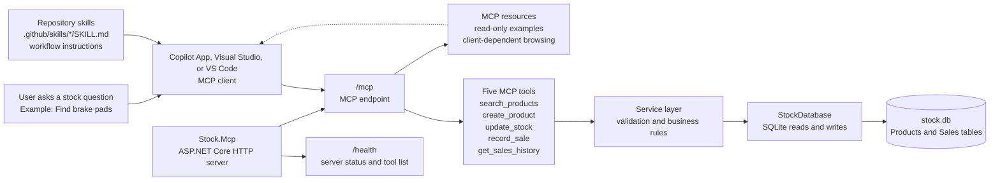

# Building for AI: Model Context Protocol (MCP) and .NET Demo

`Stock.Mcp` is a .NET 11 web-based MCP stock-control demo server for **Klipboard AI Knowledge Exchange** session.

It exposes five stock tools backed by a local SQLite database:

- `search_products`
- `create_product`
- `update_stock`
- `record_sale`
- `get_sales_history`

`RecordSale` and `GetSalesHistory` use typed date parameters. Dates are stored in SQLite as ISO 8601 text.

Sales history uses SQLite's `julianday()` to filter and sort dates by instant across UTC offsets, with millisecond-level precision. Existing records and their stored offsets are preserved.

Stock updates and sales validate and write inside SQLite transactions, so concurrent requests cannot overwrite changes using stale stock. Stock must remain between `0` and `2147483647`; only `Add`, `Remove`, and `Set` modes are accepted. `Set` assigns an absolute quantity when its transaction executes.

Business failures return MCP `isError: true` with a readable JSON `error` message. Successful tool responses retain their usual JSON fields.

Search uses SQLite `LIKE` without translation or plural handling. The assistant uses short terms in the catalogue language (English for the demo), translating descriptions or trying singular forms, synonyms, and broader terms when needed. Product codes are used directly. This is model-assisted query preparation, not guaranteed multilingual matching.

Five repository skills in `.github\skills` guide setup, stock control, product creation, sales, and reporting. Skills run on the Copilot side; they are not exposed by the MCP server. The server exposes tools and read-only resources, while application code remains responsible for validation and database changes.

## Contents

- [Quick-start checklist](#quick-start-checklist)
- [Run it yourself](#run-it-yourself)
- [Run locally](#run-locally)
- [MCP client configuration](#mcp-client-configuration)
  - [Add the server in Visual Studio](#add-the-server-in-visual-studio)
  - [Add the server in VS Code](#add-the-server-in-vs-code)
  - [Add the server in GitHub Copilot App](#add-the-server-in-github-copilot-app)
  - [Verify the connection in any client](#verify-the-connection-in-any-client)
- [Demo database](#demo-database)
- [Reset and setup](#reset-and-setup)
- [Guide](#guide)
  - [Choosing the demo client](#choosing-the-demo-client)
  - [Discovering and demonstrating skills (Skill)](#discovering-and-demonstrating-skills-skill)
  - [Optional resource demonstration (Resource)](#optional-resource-demonstration-resource)
  - [One-page architecture diagram](#one-page-architecture-diagram)
  - [What to show in code](#what-to-show-in-code)
- [Starting sample data (Skill + Tool)](#starting-sample-data-skill--tool)
- [Live demo walkthrough](#live-demo-walkthrough)
- [Fallback demo path](#fallback-demo-path)

## Quick-start checklist

1. Open the repository root in a Copilot client that supports repository skills. Keep `.github\skills` available to the chat session, not just the nested C# project.
2. Run the server on `http://localhost:5050` and connect the client to `http://localhost:5050/mcp`.
3. Check `/health` and confirm the five stock tools are available in the client.
4. Confirm the five repository skills are discovered, as described in "Discovering and demonstrating skills".
5. For a repeatable presentation, follow "Reset and setup", then ask Copilot to use `stock-demo-setup` to create the sample products.
6. Follow the live walkthrough and show both skill activation and actual MCP tool results.

## Run it yourself

Use this path if you want to repeat the demo without the presenter.

1. Install the .NET 11 SDK and use a GitHub account with Copilot access.
2. Use a Copilot client with MCP tools and repository skills. Visual Studio requires Visual Studio 2026 version 18.5 or later for skills.
3. Open the repository root as the Copilot workspace. In a terminal, change to the server project:

```powershell
cd .\Demo\Stock.Mcp\Stock.Mcp
```

4. Start the server:

```powershell
dotnet run --project Stock.Mcp.csproj --urls http://localhost:5050
```

CMD:

```cmd
dotnet run --project Stock.Mcp.csproj --urls http://localhost:5050
```

5. Open `http://localhost:5050/health` and confirm the status is `Healthy`.
6. Connect your MCP client to `http://localhost:5050/mcp`.
7. Ask the client to list the available stock MCP tools, then confirm repository skill discovery using the guide below.
8. Ask Copilot to use `stock-demo-setup` to create the sample products, or use the copy/paste request in "Starting sample data" if skills are unavailable.
9. Follow the live demo walkthrough below.
10. To start again, follow "Reset and setup".

If tools do not appear, confirm the server is still running, check `/health`, and reconnect the MCP client.

`/health` confirms application availability and lists server metadata; it does not test database connectivity.

## Run locally

Run these commands from `Demo\Stock.Mcp\Stock.Mcp`, the folder containing `Stock.Mcp.csproj`. Keep the Copilot workspace rooted at the repository so the skills remain discoverable.

```powershell
dotnet run --project Stock.Mcp.csproj --urls http://localhost:5050
```

CMD:

```cmd
dotnet run --project Stock.Mcp.csproj --urls http://localhost:5050
```

The MCP endpoint is:

```text
http://localhost:5050/mcp
```

The ASP.NET Core health endpoint is:

```text
http://localhost:5050/health
```

It returns a JSON health-check response with status, server details, and the five MCP tool names.

The health endpoint uses the shared `StockToolNames` source of truth.

Example health response:

```json
{
  "status": "Healthy",
  "name": "Stock.Mcp",
  "mcpEndpoint": "/mcp",
  "transport": "HTTP",
  "database": "SQLite",
  "tools": [
    "search_products",
    "create_product",
    "update_stock",
    "record_sale",
    "get_sales_history"
  ]
}
```

## Configuration

The SQLite database path is configured in `appsettings.json`:

```json
{
  "Stock": {
    "DatabasePath": "stock.db"
  }
}
```

Visual Studio uses `Properties\launchSettings.json` to run the HTTP server on `http://localhost:5050`.

## MCP client configuration

Adding an MCP server makes its supported capabilities available to the client; it does not install repository skills or guarantee a resource browser.

Start the server first using "Run locally" and keep its terminal running. Use these values in all three clients:

| Setting | Value |
|---|---|
| Server name or ID | `stock` |
| Transport | HTTP / Streamable HTTP |
| Endpoint | `http://localhost:5050/mcp` |
| Authentication | None for this local demo; no token or custom headers are required |

Use `/mcp`, not `/health`, as the server endpoint. `localhost` refers to the machine or execution environment making the connection. For this walkthrough, run the client session and server locally on the same machine; a remote or cloud agent cannot assume access to your computer's localhost.

### Add the server in Visual Studio

1. Open `Demo\Stock.Mcp\Stock.Mcp.slnx` within this repository and open Copilot Chat.
2. Select **Agent** mode where a mode selector is available, then open the **Tools** picker.
3. Check whether `stock` is already listed: the solution includes `Demo\Stock.Mcp\.mcp.json`. Reuse that entry rather than adding a duplicate.
4. If it is not configured, select **+** in the tool picker, then **Add custom MCP server** where shown. Enter name `stock` and URL `http://localhost:5050/mcp`, choose HTTP if asked, and save.
5. Review any server trust request, enable the stock tools if they are disabled, and perform the connection check below.

File-based alternative: use `.mcp.json` alongside `Stock.Mcp.slnx`, not inside the nested C# project folder. Its server entry is:

```json
{
  "servers": {
    "stock": {
      "type": "http",
      "url": "http://localhost:5050/mcp"
    }
  }
}
```

Save configuration changes in Visual Studio so it reloads the server. If the current build has different menu labels, use the solution-level configuration and check the Tools picker for the resulting server.

### Add the server in VS Code

1. Open the repository root folder so `.github\skills` is available. Sign in to GitHub Copilot and open Chat.
2. In builds with a **Session Target** selector, select **Copilot**.
3. Press `Ctrl+Shift+P` and run **MCP: Add Server**. Alternatively, run **Chat: Open Customizations**, select **MCP Servers**, then **Add Server**.
4. Choose **HTTP (HTTP or Server-Sent Events)**, enter `http://localhost:5050/mcp`, and name the server `stock`.
5. Choose the configuration destination offered for the session. In the newer Copilot experience, **Global → Copilot Global** creates a personal connection shared with compatible Copilot clients on the same host. Use a workspace destination if offered and you want repository-scoped configuration.
6. Review any trust request, confirm the server and its tools are enabled, then perform the connection check below.

The repository also includes `.vscode\mcp.json` in the VS Code `servers` format shown above. If your session already discovers its `stock` entry, use that instead of adding a duplicate. Newer Copilot sessions can use native configuration separately from the editor-managed connection; use the guided setup if the existing entry does not make tools available in the active session.

### Add the server in GitHub Copilot App

1. Open a local session for this repository so `.github\skills` is available to the agent.
2. Open **Customize** in the app sidebar, then select **MCP**.
3. Check **Installed** for an existing `stock` server. Repository or Copilot CLI configuration may already provide it.
4. If absent, choose the option to add a custom server. Enter name `stock`, choose HTTP, and supply `http://localhost:5050/mcp`. No sign-in to the stock server or authentication headers are needed.
5. Save or install the entry, review any trust request, and confirm the server is enabled in **Installed**.
6. Return to the repository chat and perform the connection check below.

If the custom-server editor accepts JSON, the native Copilot configuration shape is:

```json
{
  "mcpServers": {
    "stock": {
      "type": "http",
      "url": "http://localhost:5050/mcp",
      "tools": ["*"]
    }
  }
}
```

### Verify the connection in any client

Ask:

```text
Use the stock MCP server tools to list all products and their current stock levels. Do not change any data.
```

Expand the operation and confirm an actual `search_products` call returned a `count` and `products`. An empty database can validly return zero products. A list of tool names or a plausible answer without an actual call is not a connection check.

Connecting the server provides its tools; it does not install the skills. The client must separately discover `.github\skills` from the repository. Do not copy skill definitions into the MCP JSON configuration.

Client references: [Visual Studio MCP setup](https://learn.microsoft.com/en-us/visualstudio/ide/mcp-servers?view=visualstudio), [VS Code MCP setup](https://code.visualstudio.com/docs/agent-customization/mcp-servers), and [GitHub Copilot App customization](https://docs.github.com/en/copilot/how-tos/github-copilot-app/customize-github-copilot-app#configuring-mcp-servers). Menu labels vary by version.

## Demo database

The local SQLite database is `stock.db` in the server working directory.

No authentication is required for this local demo. Revisit authentication, authorization, transport security, and network exposure before hosting beyond localhost or using real data.

## Reset and setup

Use this when preparing for a presentation or when the demo data gets into an unexpected state.

Run the following commands from `Demo\Stock.Mcp\Stock.Mcp`. Reset deletes the demo's products and sales; use it only for disposable local data. The setup skill alone does not reset existing stock or clear sales.

1. Stop the running server with `Ctrl+C`.
2. Delete the local database:

   ```powershell
   Remove-Item .\stock.db -ErrorAction SilentlyContinue
   ```

   CMD:

   ```cmd
   if exist stock.db del stock.db
   ```

3. Start the server again:

   ```powershell
   dotnet run --project Stock.Mcp.csproj --urls http://localhost:5050
   ```

   CMD:

   ```cmd
   dotnet run --project Stock.Mcp.csproj --urls http://localhost:5050
   ```

4. Check the health endpoint:

   ```text
   http://localhost:5050/health
   ```

5. Reconnect or restart the client's `stock` connection if needed. Confirm the repository skills are available.
6. In Copilot Chat, ask:

   ```text
   Use the stock-demo-setup skill to create the sample products with the stock MCP tools.
   ```

7. Approve the local tool calls if the client asks.
8. Inspect the skill activation or file-read step and the `create_product` calls. Then ask Copilot to list all products and confirm the six initial stock levels in "Starting sample data".

## Guide

This guide explains how to show repository skills guiding a workflow, MCP tools performing actions, and the server enforcing business rules.

### Goals

The demo should show:

- Copilot using MCP tools to search, create, update, and sell stock.
- Copilot discovering repository skills and applying the relevant instructions.
- A skill handling missing information or preventing an invalid action before a write.
- The MCP server validating requests before changing SQLite data.
- A small set of tools supporting realistic stock-control requests.

Demo titles identify whether the segment uses a Tool, Resource, or Skill. Most live steps combine a skill with MCP tools; resource retrieval is a separate, optional segment.

### Choosing the demo client

Use the audience's main Copilot client, provided it supports repository skills and the stock MCP tools. Rehearse in the exact client and chat experience you will present; skill discovery and UI vary.

| Client | Use it for | Presenter note |
|---|---|---|
| GitHub Copilot App | Skills and MCP tool calls | Use a repository session whose workspace includes `.github\skills`. |
| GitHub Copilot in Visual Studio | Skills and MCP tool calls | Open the solution within this repository and verify the skills are discovered. Skill support requires Visual Studio 2026 version 18.5 or later; skill-management UI varies by build. |
| GitHub Copilot in VS Code | Skills and MCP tool calls | Open the repository root and verify discovery in the selected Copilot session. |

Do not make resource browsing a prerequisite. Resources remain server capabilities, but their UI is client-dependent and the skills already contain the workflow instructions.

### GitHub Copilot App setup

Use GitHub Copilot App when demonstrating the stock tools from the app experience.

1. Open a repository session with `.github\skills` in its workspace.
2. Start the server on `http://localhost:5050`.
3. Configure the MCP server URL as `http://localhost:5050/mcp`.
4. Confirm the stock tools and the five skills are available to the chat.
5. Demonstrate the skills using the sequence below, then follow the live walkthrough.

Useful connection check:

```text
List the available stock MCP tools.
```

If Copilot does not appear to use the tools, paste:

```text
Use the stock MCP server tools to answer this. Do not answer from memory.
```

### Discovering and demonstrating skills (Skill)

The skills are repository files, not C# registrations or entries in the server's tool list:

```text
.github\skills\
  stock-demo-setup\SKILL.md
  stock-control\SKILL.md
  stock-create-product\SKILL.md
  stock-sales\SKILL.md
  stock-summary\SKILL.md
```

Before presenting:

1. Open the repository root as the workspace, or the solution within this repository in Visual Studio. Ensure the Copilot session can discover the root `.github\skills` folder.
2. Open `.github\skills\stock-create-product\SKILL.md`. Show the `name`, the `description` explaining when to apply the skill, and the instructions to collect missing fields before calling `create_product`.
3. In the client's skills/customizations view, where available, confirm all five skills are discovered and enabled. In Visual Studio builds with the Skills panel, look under the Copilot Chat **Tools** control. Do not assume every client has the same panel.
4. Start a fresh chat after adding or editing skills if the current session does not discover them. Reload or reopen the workspace if necessary. Skill files are not embedded in the server, so editing them does not require rebuilding or restarting it.
5. Confirm the server connection independently. A discovered skill does not prove that the stock MCP tools are connected.

Use natural-language requests that name the skill for a predictable demonstration. The client may also select a skill automatically based on its description; there is no required cross-client slash-command syntax.

| Skill | Request to demonstrate it | Evidence to show |
|---|---|---|
| `stock-demo-setup` | Use the stock-demo-setup skill to create the sample products with the stock MCP tools. | Skill activation or the `SKILL.md` read step; product lookups, six `create_product` calls on a clean database, and a confirmation table. |
| `stock-control` | Use the stock-control skill to find brake pads. | A short catalogue search such as `brake pad`, followed by real stock data. |
| `stock-create-product` | Use the stock-create-product skill to create a product called Premium Brake Disc. | Copilot asks for missing code and prices before a write. Continue with walkthrough step 3. |
| `stock-sales` | Use the stock-sales skill to record a sale of 4 BP123. | Availability lookup, `record_sale`, and remaining stock. Run this only at walkthrough step 8. |
| `stock-summary` | Use the stock-summary skill to create an executive stock summary. | Read-only product and sales lookups, an explicit reporting period, and a business summary. |

These are the walkthrough's actions, not an extra rehearsal to execute against the same data. Run setup once after reset, and run creation and sale examples at their numbered steps so expected stock levels remain correct.

When presenting, expand the skill activation or file-read step where the client exposes it, then expand an MCP tool call and its result. A plausible answer, or a claim that a skill was used, is not proof by itself. If the client provides no activation evidence, show the skill file and describe that limitation instead of claiming a verified activation.

Presenter talk track: **the skill explains how to do the task; the MCP tool performs the action; the server decides whether the action is valid.**

### Optional resource demonstration (Resource)

This is a read-only segment that can be shown before setup without changing the walkthrough's stock levels.

1. In a client that exposes MCP resource browsing, open `stock://samples` to show the index, then open `stock://samples/sample-catalogue`.
2. Show the six example products and the note that they are not automatically inserted into SQLite. Explain that this resource stays the same even after the live stock quantities change.
3. Contrast it with `search_products`, a **TOOL** that queries current database values, and `stock-demo-setup`, a **SKILL** that instructs Copilot to create missing sample products through tools.

If the client does not expose resources, show `Resources\StockResources.cs` and `Resources\Samples\sample-catalogue.md` in the server project. Label that as a resource implementation walkthrough, not a successful live resource read. Do not claim that opening a local Markdown file exercises MCP resource retrieval.

### One-page architecture diagram

Use this diagram before showing code. The goal is to show the full idea in one picture: Copilot does not edit the database directly; it asks the MCP server to run safe, typed stock-control actions.



Plain-English talk track:

1. The user asks a normal business question.
2. Copilot applies the relevant repository skill and chooses suitable MCP tools instead of guessing or touching the database directly.
3. The MCP server validates the request and applies the stock-control rule.
4. SQLite stores the product and sale data.
5. Skills guide the workflow without changing the C# server. Resources are optional read-only context, not executable skills.

### What to show in code

Keep the code walkthrough short and follow the same order as the story.

| File | What to show | Why it matters |
|---|---|---|
| `Program.cs` | Service registration, `.WithHttpTransport(...)`, `/health`, and `/mcp` | Shows how the web app becomes an MCP server. `/health` is an HTTP health check, not an MCP tool. |
| `Tools\StockTools.cs` | The five public MCP tools and their descriptions | Shows the actions Copilot can discover and call. |
| `Services\StockService.cs` | Simple validation and business rules | Shows that tool calls still go through normal application logic. |
| `Services\StockDatabase.cs` | Product and sales queries | Shows that the demo is backed by real SQLite data. |
| `.github\skills\stock-create-product\SKILL.md` | Metadata and missing-field instructions | Shows how a client-side skill guides a tool-based workflow without changing C# code. |
| `.github\skills\stock-demo-setup\SKILL.md` | Sample products and safe rerun instructions | Shows how a reusable workflow creates missing data without resetting existing data. |
| `Resources\StockResources.cs` and `Resources\Samples\*.md` | Resource URIs, handlers, and read-only examples | Distinguishes server resources from repository skills and live database queries. |

Skill paths above are relative to the repository root; C# and resource paths are relative to `Demo\Stock.Mcp\Stock.Mcp`.

Avoid opening every file. For a mixed audience, the most important message is the flow: **question -> tool -> validation -> database -> answer**.

Timing note: if time is running short, show one `SKILL.md`, `Program.cs`, `StockTools.cs`, then demonstrate missing-field collection and a successful stock tool call.

### Skill workflow order

The stock-controller and warehouse-manager guidance is combined in `stock-control`; sales-administrator guidance is in `stock-sales`. There is no separate persona activation step.

1. Use `stock-demo-setup` after a database reset.
2. Use `stock-control` for product searches.
3. Use `stock-create-product` to collect the missing values for BD200.
4. Use `stock-control` for stock adjustments and low-stock checks.
5. Use `stock-sales` for sales and date-based history.
6. Finish with `stock-summary` for read-only business reporting.

## Starting sample data (Skill + Tool)

Use `stock-demo-setup` to create these products through `create_product` before running the demo flow.

| ProductCode | Description | CostPrice | SellPrice | QuantityStock |
|---|---:|---:|---:|---:|
| BP123 | Premium Brake Pad | 18.50 | 39.99 | 100 |
| BP124 | Economy Brake Pad | 9.75 | 24.99 | 15 |
| OF456 | Oil Filter | 4.20 | 11.99 | 50 |
| SP789 | Spark Plug | 2.10 | 6.99 | 8 |
| FLT001 | HVAC Filter Cartridge | 12.50 | 29.99 | 30 |
| CAB005 | Sensor Cable 5m | 6.75 | 14.99 | 12 |

Skill-based setup:

```text
Use the stock-demo-setup skill to create the sample products with the stock MCP tools.
```

The skill checks existing products, creates missing ones, and verifies the result. It leaves existing stock and sales unchanged and reports differences from the sample values. Reset first if you need the exact walkthrough starting state.

Fallback setup request:

If skills are unavailable but tools work, paste the following. Explain that this demonstrates tool calling, not skill activation:

```text
Use the stock MCP tools to create these demo products. Check for existing exact product codes first and create only missing products. Do not reset existing stock or sales. Report differences or errors, then verify the resulting products:
BP123, Premium Brake Pad, cost price 18.50, sell price 39.99, stock 100.
BP124, Economy Brake Pad, cost price 9.75, sell price 24.99, stock 15.
OF456, Oil Filter, cost price 4.20, sell price 11.99, stock 50.
SP789, Spark Plug, cost price 2.10, sell price 6.99, stock 8.
FLT001, HVAC Filter Cartridge, cost price 12.50, sell price 29.99, stock 30.
CAB005, Sensor Cable 5m, cost price 6.75, sell price 14.99, stock 12.
```

If Copilot asks for confirmation before calling tools, approve the tool calls for the local demo server. Sample resource files do not seed the database automatically.

## Live demo walkthrough

Before starting, create the sample data above. Then work down this section one step at a time. Each step tells you exactly what to paste into the chosen client, what tool call you should expect, and what result to look for.

The calls shown are the main business operations, not an exhaustive trace. Skills may first look up products to resolve codes or check availability. Confirm skill use from the client's activation or file-read evidence where available, and confirm every write from the actual tool result.

### 1. Search for products (Skill + Tool)

Paste:

```text
Use the stock-control skill to find brake pads.
```

Expected tool call: `search_products(query: "brake pad")`

The assistant prepares a short catalogue term from the request. It may first search for `"brake pads"`, receive no matches, and retry with `"brake pad"` or `"brake"`.

Expected result:

| ProductCode | Description | QuantityStock |
|---|---|---:|
| BP123 | Premium Brake Pad | 100 |
| BP124 | Economy Brake Pad | 15 |

### 2. Show one product (Skill + Tool)

Paste:

```text
Tell me about BP123.
```

Expected tool call: `search_products(query: "BP123")`

Expected result:

| ProductCode | Description | CostPrice | SellPrice | QuantityStock |
|---|---|---:|---:|---:|
| BP123 | Premium Brake Pad | 18.50 | 39.99 | 100 |

### 3. Create a guided product (Skill + Tool)

Paste:

```text
Use the stock-create-product skill to create a product called Premium Brake Disc.
```

Expected behaviour: Copilot should ask for the missing product code, cost price, and sell price before calling the create tool.

When asked, paste:

```text
Use product code BD200, cost price 22.00, sell price 54.99, and starting stock 0.
```

Expected tool call: `create_product(productCode: "BD200", description: "Premium Brake Disc", costPrice: 22.00, sellPrice: 54.99, quantityStock: 0)`

Expected result: product `BD200` is created with stock `0`.

### 4. Add stock (Skill + Tool)

Paste:

```text
Use the stock-control skill to add 100 BP123 into stock.
```

Expected tool call: `update_stock(productCode: "BP123", quantity: 100, mode: "Add")`

Expected result:

| ProductCode | PreviousStock | Quantity | QuantityStock |
|---|---:|---:|---:|
| BP123 | 100 | 100 | 200 |

### 5. Remove damaged stock (Skill + Tool)

Paste:

```text
Remove 5 damaged BP123.
```

Expected tool call: `update_stock(productCode: "BP123", quantity: 5, mode: "Remove")`

Expected result:

| ProductCode | PreviousStock | Quantity | QuantityStock |
|---|---:|---:|---:|
| BP123 | 200 | 5 | 195 |

### 6. Set an exact stock level (Skill + Tool)

Paste:

```text
Set BP123 stock level to 250.
```

Expected tool call: `update_stock(productCode: "BP123", quantity: 250, mode: "Set")`

Expected result:

| ProductCode | PreviousStock | QuantityStock |
|---|---:|---:|
| BP123 | 195 | 250 |

### 7. Find low-stock products (Skill + Tool)

Paste:

```text
Use the stock-control skill to show products with less than 20 items in stock.
```

Expected tool call: `search_products(query: null, maxStock: 20)`

Expected result:

| ProductCode | Description | QuantityStock |
|---|---|---:|
| BD200 | Premium Brake Disc | 0 |
| BP124 | Economy Brake Pad | 15 |
| CAB005 | Sensor Cable 5m | 12 |
| SP789 | Spark Plug | 8 |

### 8. Record a sale (Skill + Tool)

Paste:

```text
Use the stock-sales skill to record a sale of 4 BP123.
```

Expected tool call: `record_sale(productCode: "BP123", quantitySold: 4)`

Expected result:

| ProductCode | QuantitySold | QuantityStock |
|---|---:|---:|
| BP123 | 4 | 246 |

### 9. Record field-service stock usage (Skill + Tool)

Paste:

```text
Sold 3 sensor cables for an installation job.
```

Expected tool call: `record_sale(productCode: "CAB005", quantitySold: 3)`

Expected result:

| ProductCode | QuantitySold | QuantityStock |
|---|---:|---:|
| CAB005 | 3 | 9 |

### 10. Show sales history (Skill + Tool)

Paste:

```text
Use the stock-sales skill to show BP123 sales for the current month to date.
```

Expected tool call: `get_sales_history(productCode: "BP123", fromDate, toDate)`

Expected result: the response includes the recorded sale of `4` units and states the date range and time zone used. If Copilot needs the relevant time zone, provide it before continuing.

### 11. Create an executive summary (Skill + Tool)

Paste:

```text
Use the stock-summary skill to create an executive stock summary.
```

Expected tool flow: Copilot should search products, check low stock, and use sales history for the current month to date. Sales history is per product; it should identify any partial reporting coverage. No writes should occur.

Expected result: a short business-friendly summary. Low-stock items include BD200, BP124, CAB005, and SP789. BP123 stock is `246` and CAB005 stock is `9` if the full demo flow has completed.

### 12. Show an error path (Skill + Tool)

Paste:

```text
Use the stock-sales skill to sell 999 BP124.
```

Expected tool flow: `search_products` finds BP124 with `15` units. The skill instructs Copilot to explain that `999` exceeds availability and stop before calling `record_sale`.

Expected result: a clear refusal to proceed with the sale, stating the available and requested quantities. BP124 remains at `15` and no sale is recorded.

This shows a skill guardrail, not a server error response. To explain the independent server-side safeguard, show the insufficient-stock check in `Services\StockDatabase.cs` and the `isError` conversion in `Tools\StockTools.cs`. If an invalid sale reaches the server despite the skill, its business error is:

```text
Cannot sell 999 of BP124 Economy Brake Pad because only 15 are in stock.
```

### Final BP123 check

If the walkthrough starts with BP123 at `100`, the final BP123 stock should be `246`:

| Step | Change | Stock |
|---|---|---:|
| Starting stock |  | 100 |
| Add 100 | +100 | 200 |
| Remove 5 damaged | -5 | 195 |
| Set stock level | set | 250 |
| Sell 4 | -4 | 246 |

### Known good final state

If the full walkthrough has completed from a clean setup, the key final stock levels should be:

| ProductCode | Description | Expected stock |
|---|---|---:|
| BP123 | Premium Brake Pad | 246 |
| BP124 | Economy Brake Pad | 15 |
| OF456 | Oil Filter | 50 |
| SP789 | Spark Plug | 8 |
| FLT001 | HVAC Filter Cartridge | 30 |
| CAB005 | Sensor Cable 5m | 9 |
| BD200 | Premium Brake Disc | 0 |

### Key takeaways

Use these points immediately after the live demo:

- MCP turns natural-language requests into approved application actions.
- The assistant does not need direct database access.
- Validation stays in the application, not the model.
- Skills guide workflows, MCP tools perform work, and server-side validation remains authoritative.
- Skills are repository files, not server capabilities; optional MCP resources provide read-only context.

## Risks and caveats

- This is a local demo with no authentication.
- Real deployments need auth, permissions, auditability, monitoring, and secure hosting.
- The model should not directly access the database; it should act through tools.
- Tool descriptions and validation matter because they shape safe model behaviour.
- Skills guide the model but do not grant tool permissions or replace server-side validation.
- Skill discovery and activation evidence vary by client. Rehearse in the exact presentation environment.
- Demo resources are examples, not seeded production data.

## Fallback demo path

If the chosen Copilot client cannot connect during the session:

1. Show the five tool definitions in `StockTools.cs`.
2. Show `StockDatabase.cs` to explain SQLite-backed actions.
3. Show a repository `SKILL.md` and explain how its instructions call the server's tools.
4. Walk through the live demo walkthrough using the expected results shown for each step.
5. Emphasise the architecture and reusable pattern rather than live execution.

If tools work but a skill is missing, verify the workspace includes `.github\skills`, check any client skill enablement controls, then start a new chat or reload the workspace. Restarting the MCP server does not install skills. If discovery still fails, paste the relevant skill instructions into chat and clearly label this as a manual fallback, not verified skill activation.

If Copilot is connected but does not appear to use the MCP tools, paste:

```text
Use the stock MCP server tools to answer this. Do not answer from memory.
```

If the data looks wrong, paste:

```text
Search all products and show their current stock levels.
```

If sales history does not show the recorded sale, paste:

```text
Show BP123 sales for the current month.
```
