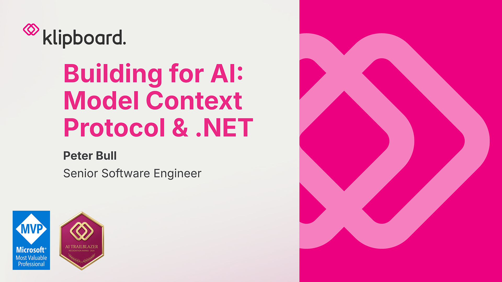

# Building for AI: Model Context Protocol & .NET

## Presentation

Here you can find Slides, Demo and Links for my presentation **Building for AI: Model Context Protocol & .NET**

## Demo

See the [DEMO.md](DEMO.md) for full end-to-end demo including prompt arguments and troubleshooting.

## Links

* [comentsys.com](https://comentsys.com)
* [rogueplanetoid.com](https://rogueplanetoid.com)
* [tutorialr.com](https://tutorialr.com)
* [modelcontextprotocol.io](https://modelcontextprotocol.io)
* [dot.net](https://dot.net)
* [gh.io/copilot](https://gh.io/copilot)
* [visualstudio.com](https://visualstudio.com)
* [code.visualstudio.com](https://code.visualstudio.com)
* [github.com/github/app](https://github.com/github/app)
* [github.com/RoguePlanetoid/ai-mcp-dotnet](https://github.com/RoguePlanetoid/ai-mcp-dotnet)